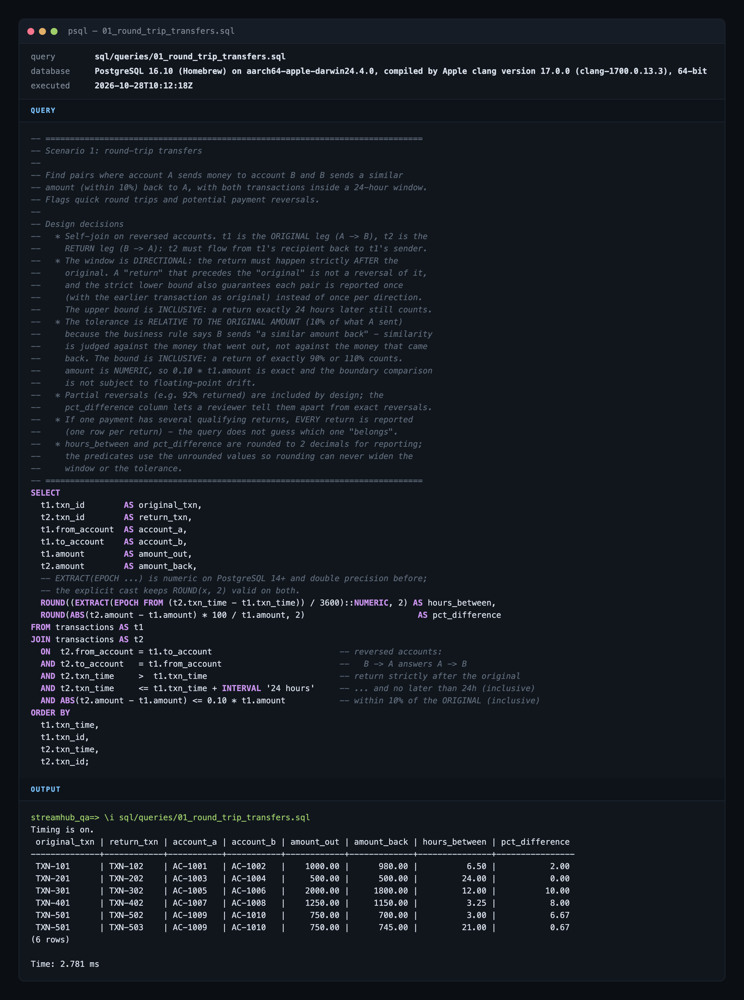
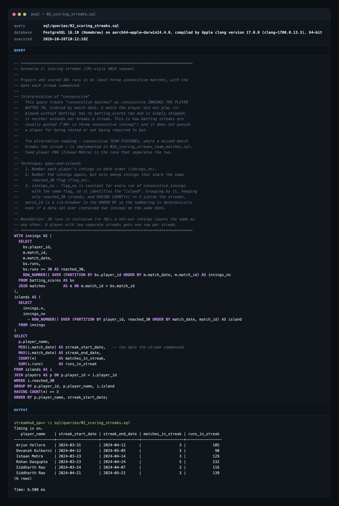
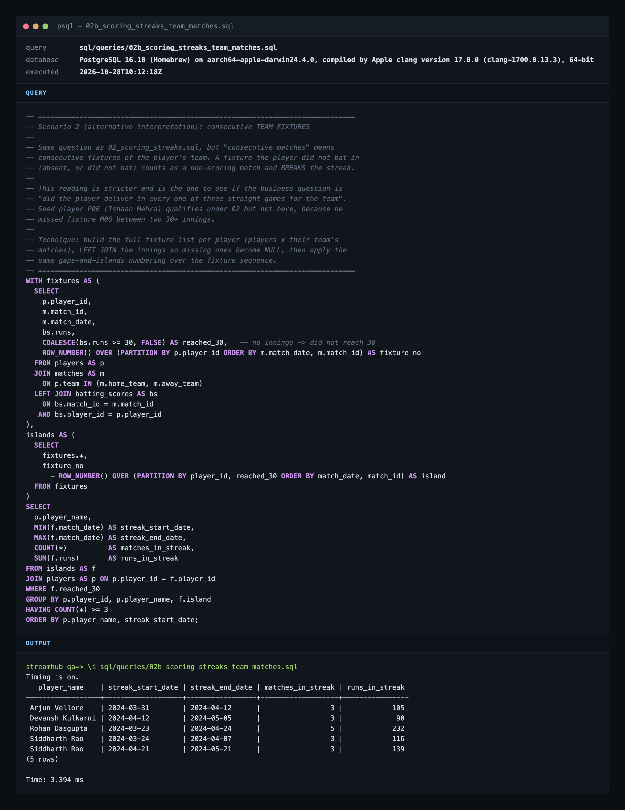

# Section B4 - SQL scenarios

Two analytical queries, the PostgreSQL schema and seed data they run against, captured
outputs and screenshots, and Cucumber scenarios that execute **the same `.sql` files** and
assert exact rows. Everything here is synthetic data built to exercise edge cases; the
cricket "season" is IPL-style but not real statistics.

| Scenario | Query | Output | Screenshot |
| --- | --- | --- | --- |
| 1. Round-trip transfers | [`queries/01_round_trip_transfers.sql`](queries/01_round_trip_transfers.sql) | [`outputs/01_round_trip_transfers.txt`](outputs/01_round_trip_transfers.txt) | [`screenshots/01_round_trip_transfers.png`](screenshots/01_round_trip_transfers.png) |
| 2. Scoring streaks (consecutive innings) | [`queries/02_scoring_streaks.sql`](queries/02_scoring_streaks.sql) | [`outputs/02_scoring_streaks.txt`](outputs/02_scoring_streaks.txt) | [`screenshots/02_scoring_streaks.png`](screenshots/02_scoring_streaks.png) |
| 2b. Scoring streaks (consecutive team fixtures) | [`queries/02b_scoring_streaks_team_matches.sql`](queries/02b_scoring_streaks_team_matches.sql) | [`outputs/02b_scoring_streaks_team_matches.txt`](outputs/02b_scoring_streaks_team_matches.txt) | [`screenshots/02b_scoring_streaks_team_matches.png`](screenshots/02b_scoring_streaks_team_matches.png) |

Automated coverage: [`tests/features/sql/round-trip-transfers.feature`](../tests/features/sql/round-trip-transfers.feature)
and [`tests/features/sql/scoring-streaks.feature`](../tests/features/sql/scoring-streaks.feature)
(`npm run test:sql`, 24 scenarios).

## Layout

```
sql/
├── schema.sql                 idempotent DDL (DROP ... CASCADE, CREATE, indexes)
├── seed.sql                   deterministic data; every row is labelled with the case it proves
├── queries/
│   ├── 01_round_trip_transfers.sql
│   ├── 02_scoring_streaks.sql
│   └── 02b_scoring_streaks_team_matches.sql
├── scripts/
│   ├── env.sh                 resolves DATABASE_URL like config/env.ts does
│   ├── setup.sh               create DB if missing, apply schema + seed      (npm run sql:setup)
│   ├── run.sh                 run every query with psql, tee to outputs/     (npm run sql:run)
│   └── render-screenshots.ts  outputs/ + queries/ -> screenshots/*.png via Playwright
├── outputs/*.txt              captured psql output (aligned, row count, timing)
└── screenshots/*.png          terminal-styled renders of query + output
```

## Schema

```
            PAYMENTS                                        CRICKET (synthetic 2024 season)

  ┌────────────────────┐                        ┌────────────────────┐      ┌─────────────────────┐
  │ accounts           │                        │ players            │      │ matches             │
  ├────────────────────┤                        ├────────────────────┤      ├─────────────────────┤
  │ account_id    PK   │◄──┐                    │ player_id     PK   │◄─┐   │ match_id       PK   │◄─┐
  │ holder_name        │   │                    │ player_name        │  │   │ match_date  NOT NULL│  │
  │ account_type       │   │  (from_account,    │ team               │  │   │ home_team           │  │
  └────────────────────┘   │   to_account)      └────────────────────┘  │   │ away_team           │  │
                           │                                            │   │ venue               │  │
  ┌────────────────────┐   │                    ┌────────────────────┐  │   └─────────────────────┘  │
  │ transactions       │   │                    │ batting_scores     │  │                            │
  ├────────────────────┤   │                    ├────────────────────┤  │                            │
  │ txn_id        PK   │   │                    │ match_id    PK,FK ─┼──┼────────────────────────────┘
  │ from_account  FK ──┼───┤                    │ player_id   PK,FK ─┼──┘
  │ to_account    FK ──┼───┘                    │ runs        >= 0   │
  │ amount  NUMERIC(14,2) > 0                   │ balls_faced >= 0   │
  │ txn_time  TIMESTAMPTZ NOT NULL              │ dismissed   BOOL   │
  │ reference          │                        └────────────────────┘
  └────────────────────┘                        (one row per innings actually batted;
  CHECK from_account <> to_account               no row = did not play / did not bat)
  INDEX (to_account, from_account, txn_time)     INDEX (player_id)
```

Design notes that matter for the queries:

- `amount` is `NUMERIC`, never float, so `0.10 * amount` is exact and the 10% boundary is a
  true equality test (`2000.00 - 1800.00 = 200.00 = 0.10 * 2000.00`).
- `txn_time` is `TIMESTAMPTZ` and the seed writes explicit `+00` offsets, so the 24-hour
  window means the same thing whatever the session time zone is.
- `transactions (to_account, from_account, txn_time)`: the round-trip self-join looks up the
  reverse leg by two equality predicates and a time range, which this index serves as a single
  range scan.
- `batting_scores (player_id)`: the streak query partitions by player; the PK leads with
  `match_id`, so a player index avoids a full scan per partition.

## Scenario 1 - round-trip transfers

> Find instances where Account A sends money to Account B, and Account B sends a similar amount
> (within 10%) back to Account A. Both transactions must happen within a 24-hour window.

### Interpretation

| Rule | Decision | Why |
| --- | --- | --- |
| Pairing | Self-join `transactions` on reversed accounts: `t2.from = t1.to AND t2.to = t1.from` | "B sends back to A" is the mirror image of "A sends to B" |
| Window | **Directional**: `t2.txn_time > t1.txn_time AND t2.txn_time <= t1.txn_time + 24h` | A "return" that precedes the "original" is not a reversal of it. The strict lower bound also guarantees each pair is reported **once**, with the earlier transfer as the original, rather than once per direction |
| Window bound | Inclusive at exactly 24 hours | "Within a 24-hour window" includes the boundary; a return at 24:00:00 counts, at 24:00:01 it does not |
| Tolerance | `ABS(t2.amount - t1.amount) <= 0.10 * t1.amount`, **relative to the original amount** | "B sends a similar amount back" is judged against what A sent out. Measuring against the return would make the test asymmetric in the wrong direction (see decoy DC-5) |
| Tolerance bound | Inclusive at exactly 10% | A return of exactly 90% (or 110%) is "within 10%" |
| Several returns | Every qualifying return is reported, one row each | The query reports candidates; deciding which return "belongs" to a payment is a separate business rule and would hide data |
| Rounding | `hours_between` and `pct_difference` are rounded to 2 dp for display only | Predicates use unrounded values, so rounding can never widen the window or tolerance |
| Order | `ORDER BY t1.txn_time, t1.txn_id, t2.txn_time, t2.txn_id` | Deterministic output for diffing and for the exact-row assertions |

### Seed cases

Transaction ids encode the case: the hundreds digit is the case number (`TXN-301`/`TXN-302`
are case RT-3). Every case sits on its own date at least three days from any other, so cases
cannot pair with each other across the 24-hour window.

**Positives (must be reported)**

| Case | Rows | What it proves | hours_between | pct_difference |
| --- | --- | --- | --- | --- |
| RT-1 | `TXN-101` -> `TXN-102` | Plain round trip: 1000.00 out, 980.00 back | 6.50 | 2.00 |
| RT-2 | `TXN-201` -> `TXN-202` | Return **exactly 24 hours** later (inclusive window) | 24.00 | 0.00 |
| RT-3 | `TXN-301` -> `TXN-302` | Return **exactly 10% lower** (inclusive tolerance): 2000.00 -> 1800.00 | 12.00 | 10.00 |
| RT-4 | `TXN-401` -> `TXN-402` | Partial reversal of 92%: 1250.00 -> 1150.00 | 3.25 | 8.00 |
| RT-5 | `TXN-501` -> `TXN-502`, `TXN-501` -> `TXN-503` | One payment, **two returns** within 24h: both reported | 3.00 / 21.00 | 6.67 / 0.67 |

**Negatives (decoys - must not be reported)**

| Case | Rows | Why it is not a round trip |
| --- | --- | --- |
| DC-1 | `TXN-601`, `TXN-602` | Returned 25 hours later |
| DC-2 | `TXN-701`, `TXN-702` | Returned 15% lower |
| DC-3 | `TXN-801`, `TXN-802` | Same direction twice (A -> B, A -> B); nothing flows back |
| DC-4 | `TXN-901`, `TXN-902` | B forwards the money to a third account C instead of back to A |
| DC-5 | `TXN-1001`, `TXN-1002` | The "reversal" is booked **before** the original: B credits A 905.00 at 08:00, A pays B 1000.00 at 12:00. Measured against 1000.00 the amounts are within 10%, so an undirected `ABS(time diff) <= 24h` query would report the pair with a negative `hours_between`. The directional window rejects that pairing, and read forwards the tolerance is 10% of 905.00 = 90.50, which 1000.00 exceeds |
| DC-6 | `TXN-1101`, `TXN-1102`, `TXN-1103` | Chain A -> B -> C -> A within three hours: the money comes back, but no pair of transactions reverses each other |
| DC-7 | `TXN-1201`, `TXN-1202` | Returned 10.01% lower (just outside the tolerance) |
| DC-8 | `TXN-1301`, `TXN-1302` | Returned 24 hours and one second later (just outside the window) |

### Expected result (6 rows)

```
 original_txn | return_txn | account_a | account_b | amount_out | amount_back | hours_between | pct_difference
--------------+------------+-----------+-----------+------------+-------------+---------------+----------------
 TXN-101      | TXN-102    | AC-1001   | AC-1002   |    1000.00 |      980.00 |          6.50 |           2.00
 TXN-201      | TXN-202    | AC-1003   | AC-1004   |     500.00 |      500.00 |         24.00 |           0.00
 TXN-301      | TXN-302    | AC-1005   | AC-1006   |    2000.00 |     1800.00 |         12.00 |          10.00
 TXN-401      | TXN-402    | AC-1007   | AC-1008   |    1250.00 |     1150.00 |          3.25 |           8.00
 TXN-501      | TXN-502    | AC-1009   | AC-1010   |     750.00 |      700.00 |          3.00 |           6.67
 TXN-501      | TXN-503    | AC-1009   | AC-1010   |     750.00 |      745.00 |         21.00 |           0.67
```



## Scenario 2 - scoring streaks

> Using an IPL-style dataset for the 2024 season, identify players who scored 30+ runs in at
> least 3 consecutive matches. Return the player's name and the date the scoring streak commenced.

### Interpretation

"Consecutive matches" is ambiguous when a player misses a game. Both readings are implemented;
the first is the default.

| | `02_scoring_streaks.sql` (default) | `02b_scoring_streaks_team_matches.sql` |
| --- | --- | --- |
| Sequence | The innings the player **batted in**, in match-date order | The player's team **fixtures**, in match-date order |
| Missed match / did not bat | Skipped: neither extends nor breaks a streak | Counts as "did not reach 30" and **breaks** the streak |
| Typical use | How batting streaks are normally quoted ("30+ in three consecutive innings"); does not punish a rested player | "Delivered in every one of three straight games for the team" |

Shared rules: 30 runs is **inclusive** (`runs >= 30`), a not-out innings counts like any other,
one row is returned **per streak** (a player with two separate streaks appears twice), and
`streak_start_date` is the date the streak commenced. Output is ordered by `player_name,
streak_start_date`.

Technique: gaps-and-islands with window functions. Each innings is numbered per player
(`ROW_NUMBER() OVER (PARTITION BY player_id ORDER BY match_date, match_id)`) and again per
player *and* `reached_30` flag; the difference of the two numbers is constant across a run of
consecutive innings with the same flag, so grouping by it isolates each streak, and
`HAVING COUNT(*) >= 3` keeps the qualifying ones. `match_id` is a tie-breaker so the numbering is
deterministic even if two innings ever shared a date.

### Seed cases

Four invented teams play a double round robin (M01-M12, 23 March - 5 May 2024) plus a qualifier
(M13, 21 May) and a final (M14, 26 May). Eight players, each built around one rule:

| Player | Innings (runs, in date order) | Rule exercised | Default query | Team-fixture query |
| --- | --- | --- | --- | --- |
| Arjun Vellore | 12, **34, 41\*, 30**, 18, 22, 27 | Exactly three consecutive 30+ (one not out) | 2024-03-31 - 2024-04-12, 3 matches, 105 runs | same |
| Rohan Dasgupta | **52, 38, 67\*, 30, 45**, 8, 21 | Five-innings streak reported as one row | 2024-03-23 - 2024-04-24, 5 matches, 232 runs | same |
| Kabir Anand | 31, 44, 29, 35, 40\*, 6 | Streak broken by a 29 | no row | no row |
| Siddharth Rao | **33, 45, 38**, 7, **61, 30, 48\***, 12 | Two separate streaks -> two rows | 2024-03-24 - 2024-04-07 (116) and 2024-04-21 - 2024-05-21 (139) | same |
| Vikram Sethi | 12, 28, 29, 0, 19, 27\*, 15 | Batted every match, never reached 30 | no row | no row |
| Ishaan Mehra | **36, 42**, _(missed M06)_, **51**, 9, 24, 14 | Missed a fixture between two 30+ innings | 2024-03-23 - 2024-04-14, 3 matches, 129 runs | **no row** (M06 breaks it) |
| Devansh Kulkarni | 5, 17, 2, **30, 30\*, 30** | Exactly 30 counts (inclusive bound) | 2024-04-12 - 2024-05-05, 3 matches, 90 runs | same |
| Naveen Pillai | _(dnb)_, 8, 31\*, 35, 4, _(dnb)_, 2, 40\* | Lower-order batter, only two consecutive 30+ | no row | no row |

`*` = not out. Full fixtures and innings are in [`seed.sql`](seed.sql).

### Expected result - `02_scoring_streaks.sql` (6 rows)

```
   player_name    | streak_start_date | streak_end_date | matches_in_streak | runs_in_streak
------------------+-------------------+-----------------+-------------------+----------------
 Arjun Vellore    | 2024-03-31        | 2024-04-12      |                 3 |            105
 Devansh Kulkarni | 2024-04-12        | 2024-05-05      |                 3 |             90
 Ishaan Mehra     | 2024-03-23        | 2024-04-14      |                 3 |            129
 Rohan Dasgupta   | 2024-03-23        | 2024-04-24      |                 5 |            232
 Siddharth Rao    | 2024-03-24        | 2024-04-07      |                 3 |            116
 Siddharth Rao    | 2024-04-21        | 2024-05-21      |                 3 |            139
```



### Expected result - `02b_scoring_streaks_team_matches.sql` (5 rows)

Identical, minus Ishaan Mehra, whose missed fixture M06 breaks his streak under this reading.



## Running it

### Locally (PostgreSQL on this machine)

`DATABASE_URL` comes from `config/env/local.env` (`postgres://localhost:5432/streamhub_qa`);
override it in a git-ignored `.env` or in the shell. The scripts resolve it the same way
`config/env.ts` does, so the shell workflow and the tests always hit the same database.

```bash
npm run sql:setup      # creates the database if missing, applies schema.sql + seed.sql
npm run sql:run        # runs every query with psql; tees aligned output + timing into sql/outputs/
npx ts-node --transpile-only sql/scripts/render-screenshots.ts   # renders sql/screenshots/*.png
npm run test:sql       # Cucumber: reloads schema + seed per scenario and asserts exact rows
```

Reports land in `reports/sql/` (`cucumber-report.html`, `cucumber-report.json`, `junit.xml`).

### With Docker Compose (no local PostgreSQL)

```bash
docker compose up -d --wait                 # postgres:16, user/password postgres, db streamhub_qa
TEST_ENV=ci npm run test:sql                # config/env/ci.env points at postgres:postgres@localhost:5432
TEST_ENV=ci npm run sql:run                 # same for the shell scripts
docker compose down -v                      # remove the container and its data volume
```

The compose file mounts `schema.sql` and `seed.sql` into `/docker-entrypoint-initdb.d/`, so the
database is already populated on first boot; `npm run sql:setup` is optional (and still safe -
the schema is idempotent).

## How the automated tests work

- `tests/steps/sql/sql-files.ts` reads `schema.sql`, `seed.sql` and `queries/<name>.sql` from
  disk and runs them through the shared `pg` pool (`this.getDb()`), so the tests exercise the
  exact files a reviewer runs by hand - no SQL is duplicated into the test code.
- `Given the analytics schema and seed data are loaded` runs in a `Background`, so every
  scenario starts from a known state no matter what ran before it.
- `Then the result should contain exactly these ... :` compares the full result set with the
  Gherkin table - same rows, same order, no extras - and the filtered variants (`the round
  trips originating from transaction "..."`, `the streaks for player "..."`) let a scenario
  state just the columns that matter for the rule it documents.
- Decoys are a `Scenario Outline` whose `Examples` table names the reason each row must be
  absent, so the report doubles as a specification.
- `DATE` columns are read back as literal `YYYY-MM-DD` text (per-query `pg` type parser) rather
  than JS `Date` objects, which avoids the classic off-by-one-day error on non-UTC machines.
- A mutation check was run while building this: making either boundary exclusive (`<` instead of
  `<=`) or changing `runs >= 30` to `runs > 30` fails the boundary scenarios.
